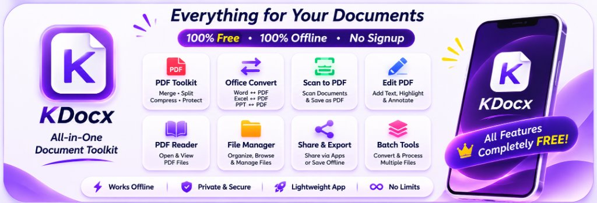

# Raj Kamal

**B.Tech CSE (Data Science) Student | Full Stack Developer | Android & AI/ML Engineer**  
*Aditya University (Class of 2027)*  
[Portfolio](https://1rajkamal.github.io/Portfolio/) • [LinkedIn](https://www.linkedin.com/in/raj-kamal-490176291/) • [GitHub](https://github.com/1rajkamal) • [Email](mailto:rajkamal9741@gmail.com)

---

## 🎯 Profile Overview

I am a Computer Science & Data Science undergraduate passionate about building high-performance Android applications, practical AI-powered systems, machine learning pipelines, and robust full-stack software solutions. My experience spans mobile engineering with Kotlin and Jetpack Compose, predictive modeling with Scikit-learn, applied Generative AI integrations, and scalable web backends with modern architectures.

---

## 🛠️ Technical Skills

### 📱 Android & Mobile Development

### 👨‍💻 Languages

### 🤖 AI, Machine Learning & Data Science

-005571?style=flat-square)

### ⚙️ Frameworks & Backend

### 💾 Databases & Storage

### 🧰 Tools & DevOps

---

## 🌟 Featured Engineering Projects

### 📱 [KDocx — Documents Made Smarter](https://github.com/1rajkamal/KDocx)
> **Your Free, Offline All-in-One Document Toolkit for Android.**

  

  
  &nbsp;
  
  &nbsp;
  
  &nbsp;
  
  &nbsp;
  

  
  &nbsp;&nbsp;
  

> **Stack:** Kotlin, Jetpack Compose, Material 3, MVVM + Clean Architecture, Dagger Hilt, Room DB, Android Graphics PdfRenderer, Coroutines & Flow  
> 🔗 **Explore / Download:** [github.com/1rajkamal/KDocx](https://github.com/1rajkamal/KDocx)

A high-performance, privacy-first Android application designed to manage, view, convert, edit, and secure your documents with **zero cloud dependencies** and **complete client-side isolation**.

#### ⚡ Why Choose KDocx?

| Benefit | Guarantee |
| :--- | :--- |
| 💸 **100% Free** | All features and tools are completely free forever — no subscriptions, paywalls, or feature locks. |
| 📴 **100% Offline** | Zero cloud APIs, no external telemetry servers. All document processing happens strictly on your device. |
| 🔓 **No Signup Required** | Instant access. Open the app and start working immediately without accounts, passwords, or emails. |
| 🛡️ **Private & Secure** | Your sensitive files never leave your phone storage; strict scoped storage and zero unauthorized modifications. |
| 🚀 **Lightweight & Fast** | Built natively with Jetpack Compose & Kotlin for blazing-fast rendering and minimal battery consumption. |

#### 🛠️ Everything for Your Documents — Core Capabilities

- 📑 **Comprehensive PDF Toolkit:** Merge multiple PDFs, split page ranges, compress file size, decrypt & password-protect, extract pages, rotate, and reorder sheets effortlessly.
- 🔄 **Local Office Document Converter:** Convert Word (`.docx`), Excel (`.xlsx`), PowerPoint (`.pptx`), and CSV to formatted PDF documents without internet access.
- 📷 **High-Resolution Document Scanner:** Integrated document camera scanner with edge detection, perspective adjustment, and one-tap PDF compilation.
- ✏️ **Edit, Annotate & Sign:** Add text watermarks, stamp digital signatures, draw annotations, and highlight directly on PDF pages.
- 📖 **High-Fidelity Document Viewers:** Original PDF reader with smooth pinch-to-zoom, translucent yellow search highlights, eye-comfort themes, and dedicated Excel & PowerPoint viewers.
- 📁 **Smart Offline File Manager:** Categorize files (PDF, Word, Excel, PPT, Code, Data), instant search, multi-attribute sorting, and fast bookmarking.

  Crafted with ❤️ by <strong>Raj Kamal</strong> • Developer of KDocx

---

### 1. [Alpha Talk — AI Chat + Secure Authentication System](https://github.com/1rajkamal/Alpha_Talk)
> **Stack:** Python, Flask, SQLite3, Bcrypt, HTML5, CSS3  
- Full-stack web application featuring cryptographically secure user authentication (Bcrypt password hashing) and session-based access control.
- Relational SQLite schema managing user profiles, display names, avatars, and timestamps.
- Interactive conversational chatbot engine with intent matching, dynamic responses, and instant AJAX messaging.
- 🔗 **Live Demo:** [alpha-kamal.onrender.com/login](https://alpha-kamal.onrender.com/login) • 🔗 **Repo:** [github.com/1rajkamal/Alpha_Talk](https://github.com/1rajkamal/Alpha_Talk)

---

### 2. [MoodSense — Text-Based Mood & Sentiment Detection](https://github.com/1rajkamal/MoodSense)
> **Stack:** Python, Flask, Scikit-learn (TF-IDF Vectorizer + Logistic Regression), Pandas, Pickle  
- AI-powered Natural Language Processing web app that analyzes typed text and classifies emotional sentiment (Happy vs Sad) in real time.
- End-to-end NLP pipeline: text preprocessing, TF-IDF feature extraction, model serialization, and probability-calibrated confidence scoring.
- Dual dataset training scripts with full classification metrics and confusion matrix validation.
- 🔗 **Live Demo:** [moodsense-1.onrender.com](https://moodsense-1.onrender.com) • 🔗 **Repo:** [github.com/1rajkamal/MoodSense](https://github.com/1rajkamal/MoodSense)

---

### 3. [LoanPredict AI — Machine Learning Credit Risk System](https://github.com/1rajkamal/loan-predictor)
> **Stack:** Python, Flask, Scikit-learn (GradientBoostingClassifier), Pandas, NumPy, Plotly.js, SQLite  
- End-to-end Machine Learning web application predicting loan approval probabilities based on 11 applicant financial attributes.
- Implements stratified train-test splitting and a tuned `GradientBoostingClassifier` with feature importance insights.
- Features real-time risk assessment, confidence metrics, automated loan recommendations, and interactive Plotly distribution charts.
- 🔗 **Live Demo:** [loan-predictor-ns16.onrender.com](https://loan-predictor-ns16.onrender.com/) • 🔗 **Repo:** [github.com/1rajkamal/loan-predictor](https://github.com/1rajkamal/loan-predictor)

---

### 4. [SmartAttend AI — Intelligent Attendance System Architecture](https://github.com/1rajkamal/smart-attend-ai)
> **Stack:** Python, FastAPI, Uvicorn, Pydantic v2, SQLAlchemy 2.0  
- High-throughput asynchronous backend designed for dynamic time-expiring QR code verification and facial recognition pipelines.
- Modular architecture with clean separation across API routers, database models, schemas, and verification services.
- Container-ready design with structured configuration management and automated health probes.
- 🔗 **Repo:** [github.com/1rajkamal/smart-attend-ai](https://github.com/1rajkamal/smart-attend-ai)

---

### 5. [AI Interview Assistant — GenAI Placement Evaluation Platform](https://github.com/1rajkamal/AI-Interview-Assistant)
> **Stack:** Python, Streamlit, Google Gemini API (`gemini-2.5-flash`), pdfplumber, python-dotenv  
- Automated interview preparation system powered by Google Gemini LLM and PDF resume parsing.
- Extracts candidate background via `pdfplumber`, dynamically generates 5 tailored domain-specific technical & HR interview questions.
- Evaluates candidate responses against interview benchmarks, providing quantitative scores (out of 10), strengths, and targeted improvement points.
- 🔗 **Repo:** [github.com/1rajkamal/AI-Interview-Assistant](https://github.com/1rajkamal/AI-Interview-Assistant)

---

### 6. [TypeRush — Distributed Full-Stack Typing Speed Platform](https://github.com/1rajkamal/Typing_Speed)
> **Stack:** TypeScript, React 18, Vite, GraphQL Yoga, Prisma ORM, PostgreSQL, Docker, Bun, JWT  
- Full-stack competitive typing speed platform built with microservices architecture and clean client-server separation.
- Backend implements GraphQL schemas, JWT session management, bcrypt password hashing, and Prisma PostgreSQL migrations.
- Complete automated test suite (unit and integration tests) and multi-stage containerized Docker development workflow.
- 🔗 **Repo:** [github.com/1rajkamal/Typing_Speed](https://github.com/1rajkamal/Typing_Speed)

---

## 📈 Engineering Activity & Problem Solving

- **C & Algorithms:** Solved 170+ core programming & data structures problems in C ([codemind-c](https://github.com/1rajkamal/codemind-c))
- **LeetCode & SQL:** Algorithmic problem-solving and relational query optimization ([leetcode](https://github.com/1rajkamal/leetcode))
- **Interactive 3D Portfolio:** Three.js / React Three Fiber interactive portfolio at [1rajkamal.github.io/Portfolio](https://1rajkamal.github.io/Portfolio/)

---

## 📬 Connect With Me

- **Portfolio:** [rajkamall.me](https://rajkamall.me/)
- **LinkedIn:** [linkedin.com/in/raj-kamal-490176291](https://www.linkedin.com/in/raj-kamal-490176291/)
- **GitHub:** [github.com/1rajkamal](https://github.com/1rajkamal)
- **Email:** [rajkamal9741@gmail.com](mailto:rajkamal9741@gmail.com)
